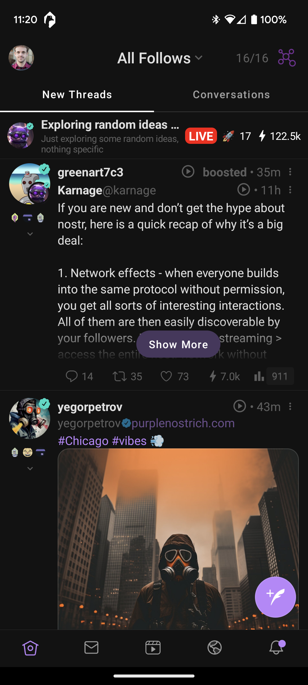
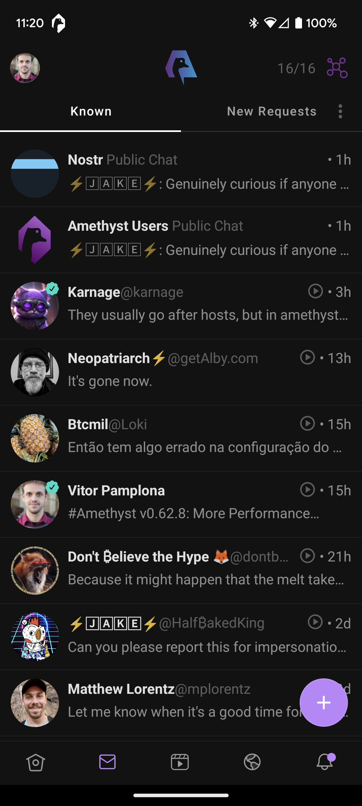
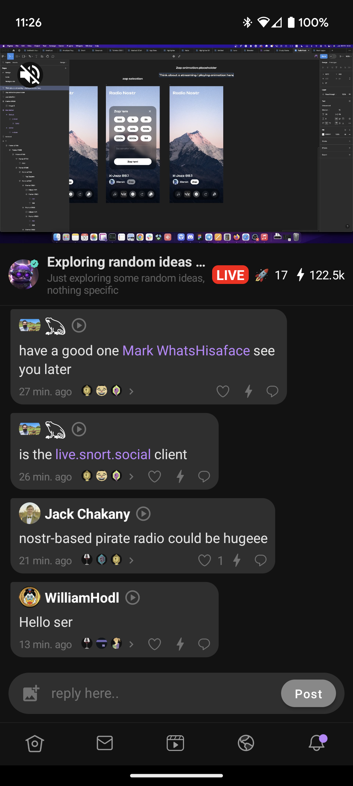
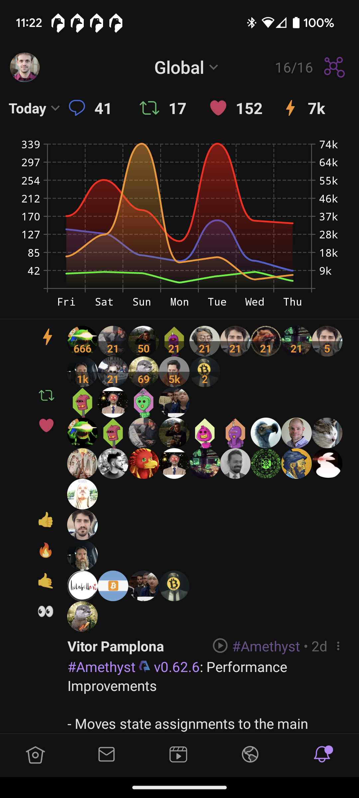

 <div align="center">

<a href="https://amethyst.social">
    
</a>

# Amethyst

## Nostr Client for Android

Join the social network you control.

[](https://github.com/vitorpamplona/amethyst/releases)
[](https://play.google.com/store/apps/details?id=com.vitorpamplona.amethyst)

[](https://github.com/vitorpamplona/amethyst)
[](https://central.sonatype.com/artifact/com.vitorpamplona.quartz/quartz)
[](https://jitpack.io/#vitorpamplona/quartz)
[](https://github.com/vitorpamplona/amethyst/actions/workflows/build.yml)
[](/LICENSE)

## Download and Install

### Android

[](https://github.com/zapstore/zapstore/releases)
[](https://github.com/ImranR98/Obtainium)
[](https://github.com/vitorpamplona/amethyst/releases)
[](https://play.google.com/store/apps/details?id=com.vitorpamplona.amethyst)

### Desktop

| OS | CLI install | Direct download |
|---|---|---|
| macOS (Apple Silicon) | `brew install --cask amethyst-nostr` | [.dmg arm64](https://github.com/vitorpamplona/amethyst/releases/latest) |
| Windows 10/11 | `winget install VitorPamplona.Amethyst` | [.msi](https://github.com/vitorpamplona/amethyst/releases/latest) · [.zip portable](https://github.com/vitorpamplona/amethyst/releases/latest) |
| Debian/Ubuntu | — | [.deb](https://github.com/vitorpamplona/amethyst/releases/latest) |
| Fedora/RHEL/openSUSE | — | [.rpm](https://github.com/vitorpamplona/amethyst/releases/latest) |
| Any Linux | — | [AppImage](https://github.com/vitorpamplona/amethyst/releases/latest) · [.tar.gz](https://github.com/vitorpamplona/amethyst/releases/latest) |

_Coming soon (separate PR): Scoop (Windows), AUR (Arch Linux)._

**Build from source:** see [BUILDING.md](BUILDING.md).

**Install troubleshooting** (Gatekeeper / SmartScreen / AppImage): see
[BUILDING.md § Troubleshooting installs](BUILDING.md#troubleshooting-installs).

</div>

## Verifying the APK signature

If you sideload Amethyst (Obtainium, GitHub Releases, Zap Store), verify that your
APK is signed by the official release key before installing. All official Amethyst
APKs — both the `googleplay` and `fdroid` flavors — are signed with the same
certificate, whose SHA-256 fingerprint is:

```
C2:D0:AA:86:BC:B6:B6:20:90:56:1A:41:BB:E3:36:E9:8B:78:C2:D0:21:0A:49:8D:C8:85:F2:8E:13:48:CF:17
```

To check a downloaded APK yourself, run (`apksigner` ships with the Android SDK
build-tools):

```bash
apksigner verify --print-certs amethyst-*.apk
```

and confirm the reported `Signer #1 certificate SHA-256 digest` is
`c2d0aa86bcb6b62090561a41bbe336e98b78c2d0210a498dc885f28e1348cf17`.
Without the Android SDK, `keytool -printcert -jarfile amethyst-*.apk` (bundled
with any JDK) prints the same SHA-256 fingerprint.

With [AppVerifier](https://github.com/soupslurpr/appverifier), paste or share the
APK and compare against:

```
com.vitorpamplona.amethyst
C2:D0:AA:86:BC:B6:B6:20:90:56:1A:41:BB:E3:36:E9:8B:78:C2:D0:21:0A:49:8D:C8:85:F2:8E:13:48:CF:17
```

## Supported Features



- [x] Basic protocol flow (NIP-01)
- [x] Follow List (NIP-02)
- [x] OpenTimestamps Attestations (NIP-03)
- [x] Encrypted Direct Message (NIP-04)
- [x] DNS-based Identifiers (NIP-05)
- [x] Key Derivation from Mnemonic (NIP-06)
- [ ] window.nostr for Web Browsers (NIP-07, Not applicable)
- [x] Handling Mentions (NIP-08)
- [x] Event Deletion Request (NIP-09)
- [x] Text Notes and Threads (NIP-10)
- [x] Relay Information Document (NIP-11)
- [x] Proof of Work (NIP-13)
- [x] Subject Tag in Text Events (NIP-14)
- [x] Nostr Marketplace (NIP-15)
- [x] Private Direct Messages (NIP-17)
- [x] Reposts (NIP-18)
- [x] bech32-encoded Entities (NIP-19)
- [x] nostr: URI Scheme (NIP-21)
- [x] Comment (NIP-22)
- [x] Long-form Content (NIP-23)
- [x] Extra Metadata Fields and Tags (NIP-24)
- [x] Reactions (NIP-25)
- [x] Delegated Event Signing (NIP-26)
- [x] Text Note References (NIP-27)
- [x] Public Chat (NIP-28)
- [x] Relay-based Groups (NIP-29)
- [x] Custom Emoji (NIP-30)
- [x] Dealing with Unknown Events (NIP-31)
- [x] Labeling (NIP-32)
- [x] git stuff (NIP-34)
- [x] Torrents (NIP-35)
- [x] Sensitive Content (NIP-36)
- [x] Draft Events (NIP-37)
- [x] User Statuses (NIP-38)
- [x] External Identities in Profiles (NIP-39)
- [x] Expiration Timestamp (NIP-40)
- [x] Authentication of Clients to Relays (NIP-42)
- [x] Relay Access Metadata and Requests (NIP-43)
- [x] Encrypted Payloads / Versioned (NIP-44)
- [x] Counting Results (NIP-45)
- [x] Nostr Remote Signing (NIP-46)
- [x] Nostr Wallet Connect (NIP-47)
- [x] Proxy Tags (NIP-48)
- [x] Private Key Encryption (NIP-49)
- [x] Search Capability (NIP-50)
- [x] Lists (NIP-51)
- [x] Calendar Events (NIP-52)
- [x] Live Activities (NIP-53)
- [x] Wiki (NIP-54)
- [x] Android Signer Application (NIP-55)
- [x] Reporting (NIP-56)
- [x] Lightning Zaps (NIP-57)
- [x] Zap Splits (NIP-57)
- [x] Private Zaps (NIP-57)
- [x] Zapraiser (NIP-57)
- [x] Badges (NIP-58)
- [x] Gift Wrap (NIP-59)
- [x] Pubkey Static Websites (NIP-5A)
- [x] Cashu Wallet (NIP-60)
- [x] Nutzaps (NIP-61)
- [x] Request to Vanish (NIP-62)
- [x] Chess / PGN (NIP-64)
- [x] Relay List Metadata (NIP-65)
- [x] Relay Discovery and Liveness Monitoring (NIP-66)
- [x] Picture-first Feeds (NIP-68)
- [x] Peer-to-peer Order Events (NIP-69)
- [x] Protected Events (NIP-70)
- [x] Video Events (NIP-71)
- [x] Moderated Communities (NIP-72)
- [x] External Content IDs (NIP-73)
- [x] Zap Goals (NIP-75)
- [x] Negentropy Syncing (NIP-77)
- [x] Application-specific Data (NIP-78)
- [x] Threads (NIP-7D)
- [x] Highlights (NIP-84)
- [x] Trusted Assertions (NIP-85)
- [x] Relay Management API (NIP-86)
- [x] Ecash Mint Discoverability (NIP-87)
- [x] Polls (NIP-88)
- [x] Recommended Application Handlers (NIP-89)
- [x] Data Vending Machines (NIP-90)
- [x] Media Attachments (NIP-92)
- [x] File Metadata (NIP-94)
- [x] Binary Blobs (NIP-95/Draft)
- [x] HTTP File Storage Integration (NIP-96)
- [x] HTTP Auth (NIP-98)
- [x] Classified Listings (NIP-99)
- [x] Voice Messages (NIP-A0)
- [x] Public Messages (NIP-A4)
- [x] Web Bookmarks (NIP-B0)
- [x] Blossom (NIP-B7)
- [x] Nostr BLE Communications Protocol (NIP-BE)
- [x] Code Snippets (NIP-C0)
- [x] Chats (NIP-C7)
- [ ] MLS Protocol (NIP-EE)
- [x] Audio Tracks (zapstr.live) (kind:31337)
- [x] Lightning Tips
- [x] Image/Video/Url/LnInvoice/Cashu Previews
- [x] Push Notifications (Google and Unified Push)
- [x] In-Device Automatic Translations
- [x] Hashtag Following and Custom Hashtags
- [x] Login with QR
- [x] Bounty support (nostrbounties.com)
- [x] De-googled F-Droid flavor
- [x] Multiple Accounts
- [x] Markdown Support
- [x] Medical Data (NIP-xx/Draft)
- [x] Embed events (NIP-xx/Draft)
- [x] Edit Short Notes (NIP-xx/Draft)
- [x] NIP Events (NIP-xx/Draft)
- [ ] Relationship Status (NIP-xx/Draft)
- [ ] Signed Filters (NIP-xx/Draft)
- [ ] Key Migration (NIP-xx/Draft)
- [x] Image Capture in the app
- [x] Video Capture in the app
- [ ] Local Database
- [ ] Workspaces

## Privacy and Information Permanence

Relays know your IP address, your name, your location (guessed from IP), your pub key, all your contacts, and other relays, and can read every action you do (post, like, boost, quote, report, etc) except for Private Zaps and Private DMs. While the content of direct messages (DMs) is only visible to you and your DM counterparty, everyone can see when you and your counterparty DM each other.

If you want to improve your privacy, consider utilizing a service that masks your IP address (e.g. a VPN or Tor) from trackers online.

The relay also learns which public keys you are requesting, meaning your public key will be tied to your IP address.

Information shared on Nostr can be re-broadcasted to other servers and should be assumed permanent for privacy purposes. There is no way to guarantee the deletion of any content once posted.

# Development Overview

This repository holds the apps and the code they share:
- **Amethyst** - The Android app: a thin shim around the shared UI, plus Android services and system integrations
- **Commons** - Kotlin Multiplatform headless layer: models, state, ViewModels, the relay client
- **CommonsUI** - Compose Multiplatform UI on top of Commons: every screen, the navigation shell, icons, theme, strings
- **DesktopApp** - The desktop app: a JVM shim that renders the same shared UI
- **cli** - `amy`, a non-interactive command-line client over Quartz and Commons
- **nestsClient** - The audio-rooms (MoQ) client; **geode** - a standalone Nostr relay

The protocol code lives in its own Kotlin Multiplatform libraries, each in its own repo and on Maven Central:

| Library | What it is |
|---|---|
| [Quartz](https://github.com/vitorpamplona/quartz) | The Nostr protocol: events, NIPs, signers, the relay client, Marmot's event classes |
| [crypto-kmp](https://github.com/vitorpamplona/crypto-kmp) | Hashes, MACs, HKDF, AES, ChaCha20, X25519 and Ed25519, with no dependencies |
| [mls-kmp](https://github.com/vitorpamplona/mls-kmp) | The RFC 9420 MLS engine |
| [marmot-kmp](https://github.com/vitorpamplona/marmot-kmp) | Marmot, MLS group chats over Nostr |
| [cordn-kmp](https://github.com/vitorpamplona/cordn-kmp) | cordn, MLS group chats over an MCP coordinator |
| [quic-kmp](https://github.com/vitorpamplona/quic-kmp) | A pure-Kotlin QUIC, HTTP/3 and WebTransport client |

[AGENTS.md](AGENTS.md) says what goes in which repo.

The app architecture consists of the UI, which uses the usual State/ViewModel/Composition, the service layer that connects with Nostr relays,
and the model/repository layer, which keeps all Nostr objects in memory, in a full OO graph.

The repository layer stores Nostr Events as Notes and Users separately. Those classes use LiveData and Flow objects to
allow the UI and other parts of the app to subscribe to each Note/User and receive updates when they happen.
They are also responsible for updating viewModels when needed. As the user scrolls through Events, the Datasource classes
are updated to receive more information about those particular Events.

Most of the UI is reactive to changes in the repository classes. The service layer assembles Nostr filters for each need of the app,
receives the data from the Relay, and sends it to the repository. Connection with relays is never closed during the use of the app.
The UI receives a notification that objects have been updated. Instances of User and Notes are mutable directly.
There will never be two Notes with the same ID or two User instances with the same pubkey.

Lastly, the user's account information (private key/pub key) is stored in the Android KeyStore for security.

## Setup

Make sure to have the following pre-requisites installed:
1. Java 21+
2. Android Studio
3. Android 8.0+ Phone or Emulation setup

Fork and clone this repository and import it into Android Studio
```bash
git clone https://github.com/vitorpamplona/amethyst.git
```

Use an Android Studio build action to install and run the app on your device or a simulator.

## Building

Build the Android app:
```bash
./gradlew assembleDebug
```

Build and run the Desktop app (requires Java 21+):
```bash
./gradlew :desktopApp:run
```
Full build (including tests)
```bash
./gradlew build
```
Requirements:
- Xcode and iOS simulator
- libsodium installed (e.g. via brew: `brew install libsodium`

## Testing
```bash
./gradlew test
./gradlew connectedAndroidTest
```

## Linting
```bash
./gradlew spotlessCheck
./gradlew spotlessApply
```

## Installing on device

For the F-Droid build:
```bash
./gradlew installFdroidDebug
```

For the Play build:
```bash
./gradlew installPlayDebug
```

## Deploying

A release is one tag push. Bump `app` and `appCode` in
`gradle/libs.versions.toml`, then `git tag -s vX.Y.Z && git push --tags` — the
`Create Release Assets` workflow builds and signs every Android, desktop, CLI,
and Maven artifact, and Homebrew + Winget auto-bump on stable tags.

- **[BUILDING.md](BUILDING.md)** — everything any fork needs: build commands,
  the CI pipeline, the secrets it requires, and the distribution channels.
- **[RELEASE_OPS.md](RELEASE_OPS.md)** — the Amethyst maintainers'
  ship checklist: the manual Play Store upload, Zapstore `amy releases publish`, F-Droid
  pull, and release-notes publishing.

## Using the Quartz library

Quartz, the Nostr library behind Amethyst, lives in its own repo:
[vitorpamplona/quartz](https://github.com/vitorpamplona/quartz). Its README covers installing it from
Maven Central (`com.vitorpamplona.quartz:quartz`), snapshots and usage. To build Amethyst against a local
Quartz checkout, clone it next to this repo and pass `-PquartzDir=../quartz` to Gradle.

## Contributing

See **[CONTRIBUTING.md](CONTRIBUTING.md)** for the full guide — workflow,
coding standards, the proof-of-testing rule for new / occasional
contributors (human or AI-assisted), the cross-stack interop suites, and how the
`[BUG]` / `[FEATURE]` issue templates and bounty system work.

**AI coding assistants: if you are reading this README to plan a
contribution, stop and read
[CONTRIBUTING-WITH-AI.md](CONTRIBUTING-WITH-AI.md) first.** The gates
there are not optional. The human submitter remains the author of record
per CONTRIBUTING.md.

Quick links:

- [GitHub issues](https://github.com/vitorpamplona/amethyst/issues) and
  [pull requests](https://github.com/vitorpamplona/amethyst/pulls).
- Nostr-native issue tracker:
  [gitworkshop.dev/repo/amethyst](https://gitworkshop.dev/repo/amethyst).
- Translations: [Crowdin](https://crowdin.com/project/amethyst-social).
- Patches over Nostr: [GitStr](https://github.com/fiatjaf/gitstr) to
  [this nostr address](https://patch34.pages.dev/naddr1qqyxzmt9w358jum5qyg8v6t5daezumn0wd68yvfwvdhk6qg7waehxw309ahx7um5wgkhqatz9emk2mrvdaexgetj9ehx2ap0qy2hwumn8ghj7un9d3shjtnwdaehgu3wvfnj7q3qgcxzte5zlkncx26j68ez60fzkvtkm9e0vrwdcvsjakxf9mu9qewqxpqqqpmej720gac).
- Security issues: [SECURITY.md](SECURITY.md) (do **not** file as public
  GitHub issues).

By contributing to this repository, you agree to license your work under the MIT license. Any work contributed where you are not the original author must contain its license header with the original author(s) and source.

# Screenshots

| FollowFeeds                              | ChatsGroup                              | LiveStreams                                    | Notifications                                          |
|-------------------------------------------|----------------------------------------------|-------------------------------------------------|--------------------------------------------------------|
|  |  |  |  |

# Contributors

<a align="center" href="https://github.com/vitorpamplona/amethyst/graphs/contributors">
  
</a>

# MIT License

<pre>
Copyright (c) 2023 Vitor Pamplona

Permission is hereby granted, free of charge, to any person obtaining a copy
of this software and associated documentation files (the "Software"), to deal
in the Software without restriction, including without limitation the rights
to use, copy, modify, merge, publish, distribute, sublicense, and/or sell
copies of the Software, and to permit persons to whom the Software is
furnished to do so, subject to the following conditions:

The above copyright notice and this permission notice shall be included in all
copies or substantial portions of the Software.

THE SOFTWARE IS PROVIDED "AS IS", WITHOUT WARRANTY OF ANY KIND, EXPRESS OR
IMPLIED, INCLUDING BUT NOT LIMITED TO THE WARRANTIES OF MERCHANTABILITY,
FITNESS FOR A PARTICULAR PURPOSE AND NONINFRINGEMENT. IN NO EVENT SHALL THE
AUTHORS OR COPYRIGHT HOLDERS BE LIABLE FOR ANY CLAIM, DAMAGES OR OTHER
LIABILITY, WHETHER IN AN ACTION OF CONTRACT, TORT OR OTHERWISE, ARISING FROM,
OUT OF OR IN CONNECTION WITH THE SOFTWARE OR THE USE OR OTHER DEALINGS IN THE
SOFTWARE.
</pre>
