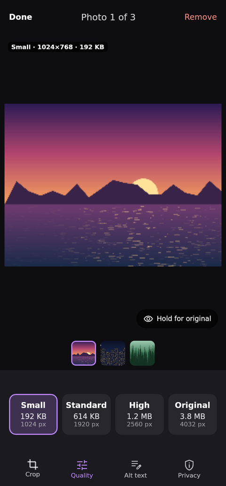
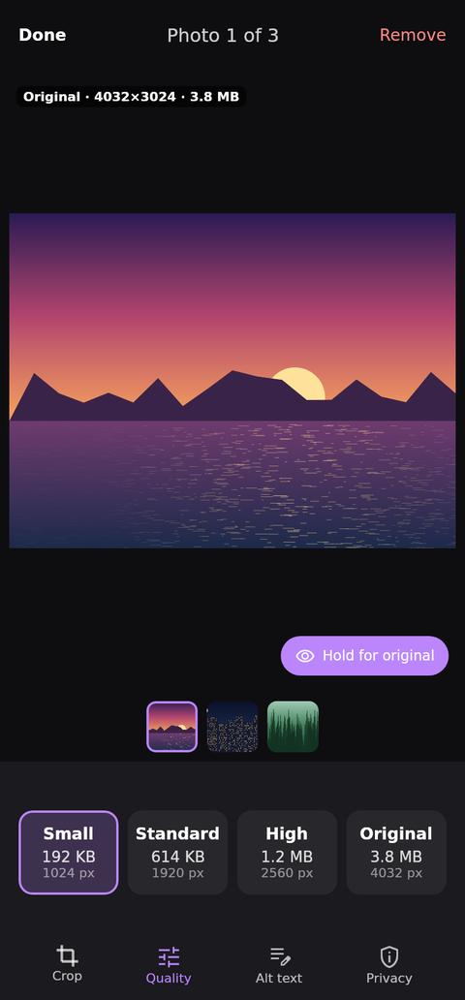
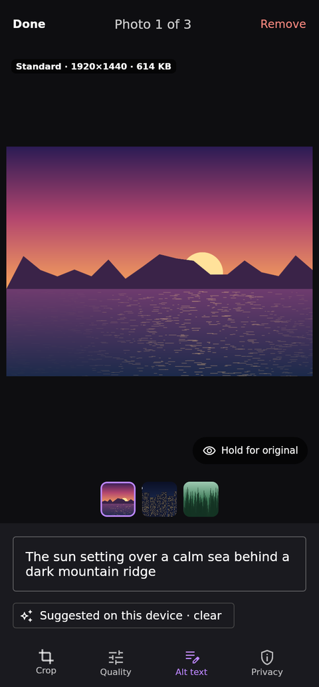
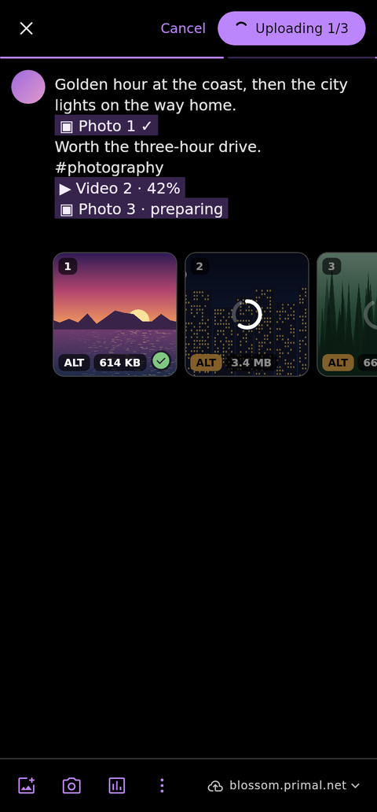

# Media in the composer: design review and prototypes

Status: proposal, with prototypes. Nothing in production changes yet.
Prototypes: `commonsUI/src/jvmTest/kotlin/com/vitorpamplona/amethyst/commons/ui/prototypes/mediacomposer/`.
Run `main` in `PrototypeGallery.kt` from the IDE to click through them, or render them all with
`./gradlew :commonsUI:jvmTest --tests "*MediaComposerPrototypesRenderTest*"` (PNGs land in
`commonsUI/build/media-composer-prototypes/`).

## 1. What we have today

Every screen that attaches a photo or video to text goes through one card,
`ImageVideoDescription` (`commonsUI/.../note/creators/uploads/ImageVideoDescription.kt`):

| Screen | File |
|---|---|
| New note / reply / quote | `screen/loggedIn/home/ShortNotePostScreen.kt` |
| NIP-22 comment | `note/nip22Comments/GenericCommentPostScreen.kt` |
| Public message | `notifications/publicMessages/NewPublicMessageScreen.kt` |
| Long-form | `discover/nip23LongForm/LongFormPostScreen.kt` |
| Git issue | `gitRepo/GitNewIssue.kt` |
| Classified | `discover/nip99Classifieds/NewProductScreen.kt` |
| Group DM (new) | `chats/privateDM/send/NewGroupDMScreen.kt` |
| Edit post | `actions/EditPostView.kt` |

Chats use their own copy of the same fields, `ChatFileUploadDialog` (`chats/utils/`). Picture posts
(kind 20) use `NewMediaView`. Avatars, banners and group icons upload straight away through
`UploadToDefaultServer` with no options at all.

The flow on a note:

1. Pick files. A bordered card appears under the text: a 20 sp title ("Add Image"), a close
   button, the thumbnails, a **File Server** spinner, a **Sensitive Content** switch with a
   one-line explainer, a **Description of the contents** field, an AI-suggestion chip, a **Remove
   private metadata** switch with an explainer, a **Media Quality** title with a 30-word
   explainer, the slider with its own label, a small compression preview with a "tap to zoom"
   line and two stats lines, then (video) an **H.265** switch with an explainer and an HDR hint,
   or (GIF) a **Convert GIF to MP4** switch with an explainer, and an **Add to Message** button.
2. "Add to Message" uploads right away, with the card's choices applied to every file.
3. On success the card goes and the URLs are pasted at the cursor. On failure a toast and the
   card stays.
4. Post is disabled while the card is open (`canPost()` checks `multiOrchestrator == null`) and
   while uploading.

### Problems

- **Two commits for one post.** The user decides twice ("Add to Message", then "Post") and pays
  for the upload before deciding to post. Files abandoned after "Add to Message" stay on the
  server. Post is greyed out with no reason given while the card is open.
- **No sense of place.** The URLs land wherever the cursor was when the upload finished, as raw
  `https://…` text. Before that, nothing in the text says where the media will go.
- **One set of options for all files.** Alt text, sensitivity and quality apply to every picked
  file. Alt text is per image by nature (NIP-92 `imeta alt` is per file).
- **The preview is split three ways.** The thumbnails at the top, the compression preview under
  the slider (fixed 1-box height, its own legend), and a second full-screen dialog
  (`CompressionZoomDialog`) to zoom into it. None of them is the zoomable viewer users already
  know from the feed (`ZoomableImageDialog`).
- **Verbose.** Roughly 120 words of explainer text are on screen for one photo before you scroll
  (counted from `strings.xml`). Seven controls are always visible, even though most users only
  ever touch alt text.
- **No editing.** No crop, rotate or trim anywhere. Users crop in another app and come back,
  and a 40-second clip uploads all 40 seconds.
- **Failure is a toast.** The error says what failed, but not which file, and offers nothing to
  do about it besides finding the card again.

## 2. Proposal

Four prototypes, one model. Each addresses the numbered request in brackets.

### The model: a draft per file, uploaded on Post [1, 4]

`MediaDraft` (prototype `MediaDraft.kt`) holds everything about one picked file: crop, trim,
mute, quality stop, alt, sensitive, strip location, and an upload status
(`Local → Preparing → Uploading → Uploaded | Failed`).

Picking a file inserts a **marker** in the text at the cursor, on its own line:
`[[media:3]]`. The marker is plain text, so undo, cut/paste, drafts and reordering by moving text
all work with no extra code. The field never shows those characters: an `OutputTransformation`
draws it, the same mechanism `UrlUserTagOutputTransformation` uses to draw `nostr:npub…` as
`@Name`. A drawn replacement is one cursor unit, so Backspace after it removes the whole marker.

**Post** uploads every draft that isn't up yet, in parallel. Only when all have succeeded do
markers become URLs, and only then is the event signed. If any fail, the composer stays as it
was. Text, edits and the successful uploads are kept, and the failed file is marked. "Cancel"
during upload returns to editing. A file already uploaded is not re-sent when the user retries
(Blossom deduplicates by hash anyway).

Production mapping: `SelectedMediaProcessing` gains the per-file options; `ShortNotePostViewModel`
keeps `MultiOrchestrator` alive until `sendPostSync()` and runs `upload()` from there;
`canPost()` drops the `multiOrchestrator == null` clause; the `iMetaAttachments.replace()` loop
runs right before signing; and `insertUrlAtCursor` becomes "replace marker *n* with its URL". The
draft store must save markers with the local URIs, so a draft restored after process death can
re-resolve them, or drop them if the file is gone.

### A. Chips + filmstrip (`MarkerStyle.CHIPS`) [1, 3]

The marker reads as a chip in the text: `▣ Photo 1`, `▶ Video 2 · 0:15`. A filmstrip under the
text shows the files, numbered to match. Each tile carries only what is uploaded: its size, an
**ALT** badge (amber when missing, the nudge to add one), CW if sensitive, and remove. Tap a tile
to open the Studio (C). The server is one chip in the toolbar (`☁ blossom.primal.net ⌄`), not a
form field.

Cheapest to build: a span style on a text replacement, plus a row of tiles.

### B. Inline blocks inside the text field (`MarkerStyle.BLOCKS`) [1, 5]

The media is drawn inside the field, where it will appear in the note. The text reads top to
bottom exactly as the posted note will. How: the transformation turns the marker into a single
transparent character in its own paragraph, styled with a `ParagraphStyle` line height equal to
the card's height. The field's `onTextLayout` reports where that line landed, and the composer
places the card over the hole. No custom text engine, and still one `TextFieldState`.

A cursor next to a block selects the block (highlighted border, caret hidden: the tall line
would otherwise draw a 230 dp caret). Backspace then removes it, the way a block editor behaves.

Costs and risks, to check on device before choosing B over A:

- IME behaviour around the tall line on Android (Gboard's cursor handles, text selection
  handles dragged across a block).
- Accessibility: the card needs its own semantics node ordered between the text paragraphs.
- Spell checking (`SpellCheckedTextField`) has to skip the marker range.
- The card has a fixed height (210 dp) for now. Using the real aspect ratio needs the field
  width, which is known after the first layout.

**Recommendation: build B, behind the same draft model, and keep A's chip as the fallback** for
the small composers (chat rows, comment sheets) where a 210 dp block doesn't fit.

### C. MediaStudio: the one place per-file choices live [2, 3, 5, 6]

| Quality | Hold for original | Crop | Trim | Alt | Privacy |
|---|---|---|---|---|---|
|  |  |  |  |  |  |

Tap any file to open it full screen. The tools are Crop, Trim (video), Quality, Alt text and
Privacy, and a strip of thumbnails switches files without going back.

- **The big picture is the compression preview** [2, 5]. It shows the file as it will be
  uploaded at the chosen stop, with pinch, double-tap and wheel zoom (`net.engawapg` zoomable, as
  `ZoomableImageDialog` and `CompressionZoomDialog` already use). **Hold for original** flips to
  the source in place and keeps the same zoom. This merges the thumbnail, the slider's small
  preview and `CompressionZoomDialog` into one surface. The badge on top says what you get:
  `Small · 1024×768 · 192 KB`.
- **Quality is four stops** that state their cost: Small / Standard / High / Original, each with
  its estimated size and long edge, or 720p / 1080p / 1440p / Original for video. That replaces
  the title, the 30-word explainer and the slider label. `MediaQualitySlider`'s real compression
  preview (`uploader.previewImageCompression`) already produces exact sizes per level, so the
  numbers can be real, not estimated.
- **Crop** [6]: aspect presets (Free, 1:1, 4:5, 16:9), drag corners or move the frame, a
  rule-of-thirds grid, Rotate, Mirror and Reset. It works in normalized coordinates, so it
  applies the same way to the full-resolution file at upload.
- **Trim** [6]: a filmstrip with two handles and the resulting length (`0:03 – 0:18 · 15 s`),
  plus a Sound switch (strip the audio track).
- **Alt text** per file, keeping today's on-device suggestion as a chip that clears it.
- **Privacy**: Sensitive (blurred until tapped) and Remove location (and camera details), one
  line each. H.265 and GIF→MP4 leave the default screen. H.265 becomes an app setting (it is a
  device-compatibility choice, not a per-post one). GIF→MP4 becomes automatic when the server
  limit or the size would benefit, with a "Keep as GIF" option in Quality.
- Edits are live on the draft. **Done** just closes, and nothing is uploaded here [4].

Implementation notes:

- Image crop and rotate: decode with the region (`BitmapRegionDecoder` on Android, Skia
  `Image.makeSubset` on desktop) inside the existing compressor step, before resizing, so it costs
  no extra pass. Crop must run before `stripMetadata` and before blurhash and thumbhash.
- Video trim: Android's compressor (LightCompressor) has no clip option. Media3 Transformer
  (`ClippingConfiguration`, androidx, Apache-2.0) does trim and mute in the same encode, and
  could later replace LightCompressor. On desktop, ffmpeg `-ss/-to` (and `-an` for mute) in the
  pipeline that already exists in `DesktopMediaUploader`.
- Icons: the bundled Material Symbols subset has no `crop`, `rotate_90_degrees_cw`,
  `content_cut` or `high_quality`. The prototypes draw stand-ins. Production adds the codepoints
  and runs `tools/material-symbols-subset/subset.sh`.

### D. Upload on Post, and recovering from a failure [4]

| Posting | Failed (inline) | Failed (chips) |
|---|---|---|
|  |  |  |

- Pressing Post locks the field, and the button counts files: `Uploading 1/3`. A 2 dp progress
  line under the top bar shows the overall progress. Every marker shows its own state: a ring on
  the card, a percentage on the chip, a check when done. **Cancel** returns to editing.
- Nothing is published until every file is up. On a failure the screen comes back: one banner
  names the file by its number (`Video 2 didn't upload`), gives the server's reason and
  "Nothing was posted.", and offers **Retry**, **Other server** and **Make smaller** (the obvious
  fix for a 413). The failed card turns red and carries its own Retry. Text, edits and the
  successful uploads are untouched.
- Leaving the screen while uploading should keep going in the background (the scheduled-posts
  service already publishes later), but that is a second step. The prototype keeps the user on
  the screen.

## 3. Words: before and after [3]

| Today | Proposed |
|---|---|
| "Add Image" card title, "Add to Message" button | gone: no card, no second commit |
| "File Server" spinner | `☁ blossom.primal.net ⌄` chip, only shown when there is media |
| "Sensitive Content" + "Adds sensitive content warning before showing this content" | "Sensitive" · "Blurred until tapped", in Privacy |
| "Description of the contents" + "A blue boat in a white sandy beach at sunset" | "Alt text" tab · "Describe it for people who can't see it" |
| "Remove private metadata" + "Attempts to strip private metadata from supported media files before uploading" | "Remove location" · "And camera details" |
| "Media Quality" + 30-word explainer + slider label | four labelled stops with their sizes |
| "Tap the image to zoom in and compare it with the original" + two stats lines | the picture is zoomable; "Hold for original"; one badge |
| "Use H.265/HEVC Codec" + explainer, HDR hint | moved to Settings › Media |
| "Convert GIF to MP4" + explainer | automatic, "Keep as GIF" in Quality |
| Toast "Failed to upload media" | banner naming the file, the reason, and three fixes |

About 120 words of explainer before the first scroll become under 15, and the defaults on the
composer screen are a single chip.

## 4. Elsewhere

- **Chats** (`ChatFileUploadDialog`): same draft and Studio. Send = upload then send, with the
  same failure banner above the input. The marker style is the chip (A) inside the input row,
  with a thumbnail tray above it.
- **Picture posts** (`NewMediaView`, kind 20): the Studio is the screen, with the caption under it.
- **Avatar, banner and group icon**: open the Studio with Crop locked to 1:1 (avatar) or 3:1
  (banner) before the immediate upload. Today a wide photo becomes a squashed or centre-cut avatar.
- **Long-form**: markers fit Markdown well (`` replaces the marker at publish).

## 5. Suggested order

1. Draft model + upload-on-Post in `ShortNotePostViewModel`, with chips (A) and the failure banner
   (D). This is the behaviour change, and it can ship on its own.
2. MediaStudio with Quality (real compression previews), Alt and Privacy. Retire
   `ImageVideoDescription` and `CompressionZoomDialog`.
3. Crop and rotate (both platforms), then Trim and mute (Media3 Transformer on Android, ffmpeg on
   desktop).
4. Inline blocks (B) in the note composer, after an on-device IME check.
5. Move the other composers (comments, chats, long-form, classifieds, git issues, group DMs) onto
   the shared pieces.

## 6. What the prototypes are and aren't

They are Compose code in a test source set (`jvmTest`), so they ship in no artifact and their
English labels are hard-coded on purpose. Production strings go to `commonsUI` compose resources.
They run with a fake uploader (`PrototypeComposer.post()` simulates progress, and
`failNext` forces a failure), procedural stand-in images (`SyntheticMedia.kt`), and a simulated
compression (downscale and upscale) instead of real files. Crop, trim, zoom, hold-to-compare,
remove, retry and server switching all work interactively in the gallery window.

`PrototypeComposerBehaviourTest` checks the claims this doc makes about behaviour:

- Post turns every marker into its URL only after all uploads succeed.
- A failure leaves the text and markers byte-for-byte unchanged, and Retry then finishes the post.
- Backspace after a chip, or after an inline block, removes the whole `[[media:n]]` marker
  (tested by sending a real key event to the field).

The screenshots in `screenshots/` are the render test's output, scaled down.
