# Media in the composer: design review and prototypes

Status: proposal, with prototypes. Nothing in production changes yet.
Prototypes: `commonsUI/src/jvmTest/kotlin/com/vitorpamplona/amethyst/commons/ui/prototypes/mediacomposer/`.
Run `main` in `PrototypeGallery.kt` from the IDE to click through them (tabs: Post, Reply,
Chat, Profile, Failure; the add buttons open the Studio), or render them all with
`./gradlew :commonsUI:jvmTest --tests "*MediaComposerPrototypesRenderTest*"` (PNGs land in
`commonsUI/build/media-composer-prototypes/`).

## Status

**Where it runs.** The flow below is one shared piece, `AttachedMediaState` (pick, markers,
reopen, upload on Post, draft stripping), with `AttachedMediaStudioDialogs`,
`rememberAttachedMediaBlocks` and `rememberMediaMarkerField` for any text field. It runs in the
note composer, comments (NIP-22), public messages, long-form (Markdown body), edit post and git
issues. Classifieds use the Studio with Add uploading at once, since their photos are listing
images rather than links in the text.

**Chats** keep their send-the-files flow, now in the Studio. `ChatFileUploadDialog` is a wrapper
over `MediaStudioDialog` with a Send button (Add on the new group DM screen, where files wait for
the message). It covers DMs, public channels, Concord, Marmot, cordn, minichat, nests and the new
group DM screen.
- Each file goes with its own quality, metadata strip and content warning.
- Its alt text is the description the message carries; it used to be one "caption" for every file.
- NIP-17 chats keep the encrypt switch (in Privacy), cordn has no sensitive switch, and a Buzz
  workspace's locked server is the only one offered.
- `MultiOrchestrator.uploadOwnOptions` / `uploadEncryptedOwnOptions` carry the per-file options
  through the encrypted path and its plaintext retry; their results name the file.
- The old card (`ImageVideoDescription`) is deleted.

**Picture and video posts** (`NewMediaView`, from the Pictures, Shorts, Videos and Longs feeds and
their share targets) are the Studio with a caption field and Post.
- Each file goes with its own options (`uploadEach`; a retry sends only what failed).
- Each image carries its own `alt` in the picture event (`sendAllAsOnePictureEvent(altByUrl)`),
  where every image used to get the caption.
- A video's post text is the caption while its `imeta` alt is its own (`sendHeader(content)`).
- A content warning on any image covers the picture post.
- A failed upload no longer leaves Post disabled for good.

**Avatar, banner and icon uploads** crop first. Picking a still picture opens `ImageCropDialog`
(studio package): the picture on the Studio's black stage with a frame on it, corners to resize,
drag inside to move, Reset, and Save.
- `ImageCropShape.Avatar` and `.Icon` lock a square and dim outside a circle (how they display);
  `.Banner` locks 3:1.
- Save writes the crop with `MediaUploader.cropImage` (new): the camera's orientation applied to
  the pixels, no metadata kept, PNG when the picture has transparency, JPEG 92 otherwise. Desktop
  is `ImageCropper` (commons jvmMain: ImageIO, Skia for WebP); Android decodes with
  `BitmapFactory` sampled to a 2,048–4,096 px long edge and turns it with `ExifInterface`.
- The screens keep their own upload: `SelectSingleFromGallery(crop = …, uploader = …)` and
  `GallerySelectSingleCropped` hand them the cropped file. GIFs and SVGs skip the crop (it would
  lose the animation), and a picture the platform can't decode says so and Save uses it whole.
- Where: profile edit (avatar, banner), the profile header's add-a-picture button, NIP-28 channel,
  relay (NIP-29) group, Concord icon and banner, Marmot group icon.
- Tests: `ImageCropperTest` (commons, an EXIF-rotated JPEG and a transparent PNG), `ImageCropTest`
  (commonsUI, the drag math and renders).
- Still uncropped: emoji, list and pack covers, nests, geocaches, drss, podcast and music art.

**Crop in the Studio** (posts, comments, long-form, picture posts, chats; every screen on
`MediaStudio`). A Crop tool sits beside Quality for still pictures the platform re-encodes (not
GIF, SVG or AVIF).
- The stage becomes `CropEditor` (shared with the avatar dialog) and the panel offers Free, 1:1,
  4:5, 3:2 and 16:9, plus Reset. A reopened Studio holds the shape the crop already has.
- The crop is a per-file option, `MediaUploadOptions.crop` (normalized, as the picture displays;
  null when it keeps the whole picture), so it travels with the file like quality and alt text.
- Upload: `MultiOrchestrator` crops right before each upload (`withCrop`, in `uploadEach`,
  `uploadOwnOptions` and `uploadEncryptedOwnOptions`) and deletes the copy after. The crop is part
  of `UploadSettings`, so a changed crop sends again and an unchanged one is reused. A crop that
  can't be written fails that file (`UploadError.CROP_FAILED`) instead of sending the whole picture.
- Quality previews are made from the cropped copy (`CroppedSources`), so the stage, the sizes and
  hold-for-original show the part that will be sent.
- The composer's inline card and the Studio thumbnails draw the crop without re-encoding
  (`CroppedImage`), and the card takes the cropped shape (`SelectedMediaProcessing.sentAspectRatio`).
- Tests: `MultiOrchestratorUploadEachTest` (crop sent then deleted, failed crop sends nothing, a new
  crop resends, GIFs skip, encrypted path), `ImageCropTest`, `MediaStudioRenderTest` (`crop`,
  `quality-cropped`).

**Trim in the Studio.** Videos get a Trim tool where the platform can cut one
(`MediaUploader.videoTrim`: always on Android, with ffmpeg on desktop).
- The panel is a filmstrip of eight frames with the kept part framed. Drag an end to move it
  (never under one second) or drag inside to slide the whole part; Reset keeps all of it.
- The stage shows the frame at the edge being dragged, with its time. The label reads
  `0:03.0 – 0:09.1 · 6.1 s`.
- The trim is a per-file option, `MediaUploadOptions.trim` (`VideoTrim`, null when all of it is
  kept). `MultiOrchestrator.withEdits` cuts it right before the upload, then compression and
  stripping run on the cut as before. A trim that can't be written fails that file
  (`UploadError.TRIM_FAILED`).
- The cut is lossless: tracks are copied, so it starts on the key frame at or before the start.
  - Desktop: ffmpeg stream copy (`FfmpegCommandBuilder.trim`).
  - Android: `VideoTrimmer`, the platform's `MediaExtractor` and `MediaMuxer`, with the rotation
    hint kept.
- Frames come from `MediaUploader.videoFrame` (JPEG bytes, so commons stays headless).
  - Desktop: ffmpeg.
  - Android: `MediaMetadataRetriever`.
  - That also gives desktop its first video frames: the Studio's video stage and the composer
    card now show the first frame that will be sent, where they were blank before. The card also
    shows the trimmed length.
- Tests: `MultiOrchestratorUploadEachTest` (trim sent then deleted, failed trim sends nothing,
  encrypted path), `DesktopVideoTrimTest` (real ffmpeg: the cut's length and tracks, upright
  capped frames), `MediaStudioRenderTest` (`trim`).

**Implemented (described for the note composer, `ShortNotePostScreen`):**

1. **Studio after every pick.** Picking files opens `MediaStudioDialog`
   (`commonsUI/.../note/creators/uploads/studio/`) instead of the `ImageVideoDescription` card.
   - Every file carries its own `MediaUploadOptions` (alt, sensitive, quality, strip metadata,
     H.265, GIF→MP4) on `SelectedMediaProcessing.options`.
   - The preview is the real compressed file (`MediaUploader.previewImageCompression`),
     zoomable, with hold-for-original. Each level shows the size and long edge it really produces.
   - Tools: Quality, Alt text (on-device suggestion for every image), Privacy. A server chip.
2. **Markers and upload on Post.** Add uploads nothing:
   - Each file leaves a `[[media:N]]` marker (`MediaMarkers`, commons) at the cursor, on its own
     line. The field draws it as the media itself, inside the text where it will appear in the
     note (design B):
     - `UrlUserTagOutputTransformation` turns the marker into one invisible character on a line
       as tall as the card. It's one replacement list with the mentions, so the spell checker
       stays aligned.
     - `ThinPaddingTextField.textOverlay` lets `MessageField` place an `AttachedMediaCard` in
       that gap.
     - The cursor against a card selects it: outline, no caret. Backspace removes it, and undo
       brings it back with its settings.
     - `MentionPreservingInputTransformation` keeps markers whole against IME partial edits.
   - Each card takes its media's shape (`SelectedMediaProcessing.displayAspectRatio`, read when its
     picture or video frame loads) at the field's width, between 120 and 420 dp, and its gap in
     the text follows.
   - The card shows an ALT badge (amber when missing), CW, the quality and remove. Tapping it
     reopens the Studio ("Done"). A chip style (`MediaMarkerChips`) remains for fields too small
     for a card. The field takes the focus back after Add.
   - `sendPostSync()` now returns a Boolean. It first uploads every attached file with its own
     options (`MultiOrchestrator.uploadEach`), then swaps markers for URLs and records each
     file's `imeta`, and only then builds and signs the event. If any upload fails it returns
     false: the screen stays, the text and the files are untouched, the strip names the file and
     the server's reason, and Post retries only what failed.
   - Markers never leave the device. Drafts save the text without them (the picked files can't
     travel with a draft), and link previews ignore them. A marker whose file is gone is
     dropped at Post.
   - At Post a URL always lands on a line of its own, even if the user deleted the line break
     around its marker.
   - Tests: `MediaMarkersTest`, `MultiOrchestratorUploadEachTest` (commons);
     `MediaStudioRenderTest` (commonsUI); `MediaStudioUiTest`, `MediaMarkerFieldUiTest`
     (desktopApp, real clicks and keys).

**Desktop `imeta` dimensions.** The desktop's upload metadata (`readDesktopUploadMetadata`) adds
Skia for images ImageIO can't decode (WebP), and ffprobe's display size, after any rotation flag,
for videos and AVIF. Before, an `imeta` from desktop had no `dim` for any video or for a WebP or
AVIF sent as the original. Hooked in through `UploadOrchestrator(readMetadata = …)`. Tested on
real files in `DesktopUploadMetadataTest`. SVG and HEIC (no decoder) still get none.

**Sound files and documents.**
- **No strip owed for documents.** A PDF or an archive never asks for a metadata strip
  (`MediaUploadOptions.defaultFor`, and `MultiOrchestrator` refuses one when it sends). No platform
  can strip such a file, and with the Studio hiding the switch, Android asked "couldn't remove
  metadata, upload anyway?" on every PDF.
- **Voice memos saved as `.mp4` are audio.** `SelectedMediaProcessing.checkType` runs as the Studio
  opens and before every upload. It reads the file's track list (`refineMediaType`, through
  `probeMp4AudioOnly` and the new `MediaUploader.readRange`). An MP4-family file whose tracks are all
  sound becomes `audio/mp4`: no video tools, no failed encode, no strip prompt.
- **Desktop strips sound files.** ffmpeg remuxes them without tags (artist, title, location, cover
  art, chapters; no ID3 block for MP3), the way it already remuxed video. The prompt is only shown
  when that fails. "Remove location" now says "And title, artist and other tags" for sound.
- **Cards for files with no picture.** Sound files and documents are a 64 dp row: an icon (sound,
  PDF, file), the name, its type and size, and a CW badge. They were 220 dp boxes showing only the
  MIME type. Their markers read "Audio N".
- **Tests:** `MediaTypeRefinementTest`, `MultiOrchestratorUploadEachTest.aDocumentOwesNoMetadataStrip`,
  `DesktopAudioUploadTest` (real ffmpeg), `MediaStudioRenderTest` (`audio`, `pdf`, `file-cards`).
- **Still open:** desktop's Files button is a stub, so a PDF can't be attached there.

**GIFs and animated WebP.** A GIF left alone still goes up as the same file. An edited one stays a GIF.
- **Playing.** GIFs play in the Studio's stage and thumbnails and in the composer's card on
  desktop too. `CroppedImage(animated = true)` draws through the platform's `AnimatedImage`, and
  desktop's `AnimatedGifImage` now reads local files. A moving picture's shape comes from its
  header (`PictureHeaders.gifSize`, `webpCanvasSize`), since the player reports no size.
- **Crop and trim, still a GIF.** `GifEditor` (commons, pure Kotlin, so every platform has it
  without an encoder of its own) decodes each frame onto the canvas the way browsers do (disposal,
  transparency, interlace). It crops, keeps the frames the trim covers, and shortens the two the
  cut runs through. It writes a GIF with the source's colors exactly, its frame delays and its loop
  count. Unchanged pixels go out transparent and the source's colors as one table, so a straight
  re-write comes out the size of the source. "Convert GIF to MP4" stays an optional switch, applied
  after the edit.
  - It also gives the Trim tool a GIF's frames (`frameAt`, a one-frame GIF), and
    `PictureHeaders.gifDurationMs` its length, on both platforms.
  - Desktop no longer needs ffmpeg for GIFs, and Android no longer uses `android.graphics.Movie`
    and gets crop too.
- **Animated WebP.** It is found by its header (`refineMediaType` sets `SelectedMedia.animated`;
  the avatar crop step checks too). It gets no Crop and no Quality re-encode, and Android's
  `MediaCompressor` uploads it unchanged at any quality. It used to keep one frame.
- **Tests:**
  - `GifEditorTest`: GIFs written by the JDK's own GIF writer, read back frame for frame; crops
    exact and read back by the JDK's reader; trims, transparency, more than 256 colors, LZW round
    trips.
  - `PictureHeadersTest`, `MediaTypeRefinementTest`.
  - `DesktopGifEditTest` (real ffmpeg): every kept frame of a cropped and trimmed GIF equals the
    source's pixels as ffmpeg decodes both; an untouched GIF is sent as is.

Not yet:
- rotate and mirror in the crop; playing the trimmed part in the Studio (the stage shows frames, not playback)
- the long-form preview shows the text without the attached media until it is posted
- keeping attached files in a draft across app restarts

### Feedback round, 2026-11-18

Fixed after the first testers' report, and checked by posting from a new account on the desktop
app (phone-sized window):
- **Trim plays the kept part.** Play on the Trim stage (or a tap on it) loops start to end with
  sound: `NotePlatform.TrimPreviewPlayer`, a clipped ExoPlayer on Android and the shared engine on
  desktop (left out of the now-playing bar). A GIF plays its trimmed copy (`rememberTrimmedGif`),
  which the Studio's other tools and the composer's card now show too.
- **GIFs trim.** The 1 s minimum left a one-second GIF nothing to cut (GIFs now go down to 100 ms),
  each drag step was snapped back to "all of it" on short clips (steps are now worked out from
  where the drag began), and a handle pulled inward read as "move both" past the touch slop.
  `StudioTrimUiTest` drives both.
- **One wheel per upload, with its stage.** The composer's cards say Compressing, Uploading,
  Processing… again; the gallery and file buttons no longer spin for files that show on cards
  (only for a drawing), and the Studio's Add button no longer spins over its own overlay.
- **Text above the media.** Files added at the start of the text leave an empty first line with
  the cursor on it; Post drops that line if nothing was written there.
- Transitions: the stage keeps a still across tools and while a player opens, the panel eases
  between tool heights, and the probe and length are read once per file.

Still open:
- On Post the markers become URLs in the field before signing, so the URLs show for as long as
  signing takes (a frame with a local key, seconds with a NIP-46 bunker), then the cleared composer
  shows briefly before it closes. Fix: build the event from the resolved text and leave the field
  alone (every composer that uses `AttachedMediaState` reads `message.text` after `uploadAll`).
- "Original video kept" opens a modal in the middle of posting that outlives the composer; a
  quiet line on the card or a toast would do.
- Desktop dialogs (composer, Studio) open and close with a hard cut; Android's dialog windows fade.

## 1. What we have today

Every screen that attaches a photo or video to text goes through one card,
`ImageVideoDescription` (`commonsUI/.../note/creators/uploads/ImageVideoDescription.kt`):

| Screen | File |
|---|---|
| New note / reply / quote | `screen/loggedIn/home/ShortNotePostScreen.kt` |
| NIP-22 comment | `note/nip22Comments/GenericCommentPostScreen.kt` |
| Public message | `notifications/publicMessages/NewPublicMessageScreen.kt` |
| Long-form | `discover/nip23LongForm/LongFormPostScreen.kt` |
| Git issue | `gitRepo/GitNewIssue.kt` |
| Classified | `discover/nip99Classifieds/NewProductScreen.kt` |
| Group DM (new) | `chats/privateDM/send/NewGroupDMScreen.kt` |
| Edit post | `actions/EditPostView.kt` |

Chats use their own copy of the same fields, `ChatFileUploadDialog` (`chats/utils/`). Picture posts
(kind 20) use `NewMediaView`. Avatars, banners and group icons upload straight away through
`UploadToDefaultServer` with no options at all.

The flow on a note:

1. Pick files. A bordered card appears under the text: a 20 sp title ("Add Image"), a close
   button, the thumbnails, a **File Server** spinner, a **Sensitive Content** switch with a
   one-line explainer, a **Description of the contents** field, an AI-suggestion chip, a **Remove
   private metadata** switch with an explainer, a **Media Quality** title with a 30-word
   explainer, the slider with its own label, a small compression preview with a "tap to zoom"
   line and two stats lines, then (video) an **H.265** switch with an explainer and an HDR hint,
   or (GIF) a **Convert GIF to MP4** switch with an explainer, and an **Add to Message** button.
2. "Add to Message" uploads right away, with the card's choices applied to every file.
3. On success the card goes and the URLs are pasted at the cursor. On failure a toast and the
   card stays.
4. Post is disabled while the card is open (`canPost()` checks `multiOrchestrator == null`) and
   while uploading.

### Problems

- **Two commits for one post.** The user decides twice ("Add to Message", then "Post") and pays
  for the upload before deciding to post. Files abandoned after "Add to Message" stay on the
  server. Post is greyed out with no reason given while the card is open.
- **No sense of place.** The URLs land wherever the cursor was when the upload finished, as raw
  `https://…` text. Before that, nothing in the text says where the media will go.
- **One set of options for all files.** Alt text, sensitivity and quality apply to every picked
  file. Alt text is per image by nature (NIP-92 `imeta alt` is per file).
- **The preview is split three ways.** The thumbnails at the top, the compression preview under
  the slider (fixed 1-box height, its own legend), and a second full-screen dialog
  (`CompressionZoomDialog`) to zoom into it. None of them is the zoomable viewer users already
  know from the feed (`ZoomableImageDialog`).
- **Verbose.** Roughly 120 words of explainer text are on screen for one photo before you scroll
  (counted from `strings.xml`). Seven controls are always visible, even though most users only
  ever touch alt text.
- **No editing.** No crop, rotate or trim anywhere. Users crop in another app and come back,
  and a 40-second clip uploads all 40 seconds.
- **Failure is a toast.** The error says what failed, but not which file, and offers nothing to
  do about it besides finding the card again.

## 2. Proposal

**One flow on every screen that takes media: pick → MediaStudio → result in place → tap to
reopen.** Picking files always opens the Studio, configured for the screen that asked. Its
confirm button hands the edited files back, and the screen shows them where they belong:
inline in a post, as a message in a chat, or in the avatar circle. Tapping a file reopens the
Studio on it. The screens themselves carry no media settings.

| 1. Pick → Studio ("Add") | 2. Added as an inline block | 3. A post with three files |
|---|---|---|
| 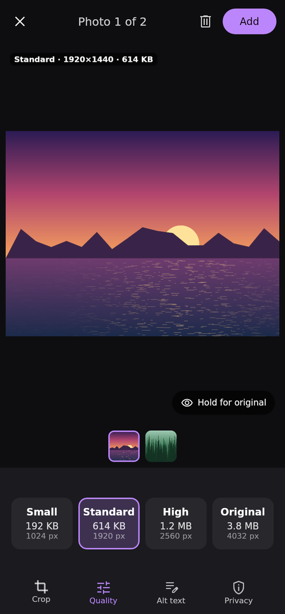 | 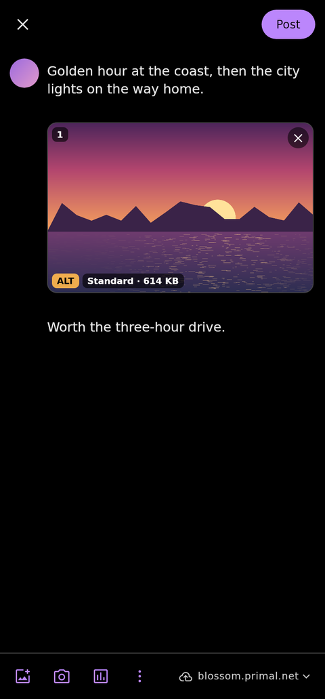 | 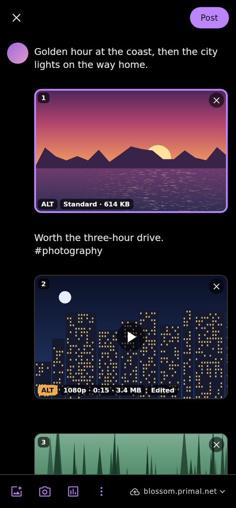 |

The Studio (prototype `MediaStudio.kt`) knows nothing about its host. It takes a list of drafts,
a `StudioConfig`, and confirm/cancel/remove callbacks:

| Host | Config | Confirm | Then |
|---|---|---|---|
| Note, comment, long-form, issue, classified (after a pick) | `postPick()`: all tools | **Add** | markers go in the text at the cursor, drawn as blocks (B) |
| Same, file tapped in the post | `postEdit()` | **Done** | closes; edits are already on the draft |
| Reply sheets, other small composers | same configs | Add / Done | chips + filmstrip (A): a 210 dp block doesn't fit |
| Chat / DM | `chat(caption)`: all tools + caption | **Send** (beside the caption) | the bubble uploads, then sends |
| Avatar | `avatar()`: crop only, locked 1:1, circle mask | **Save** | uploads right away |
| Banner | `banner()`: crop + quality, locked 3:1 | **Save** | uploads right away |

Cancel (the ✕, shown only when the Studio was opened by a pick) undoes the pick. Nothing reaches
the text or the chat until the user confirms, so backing out leaves no trace. Every option starts
at a default, so a user who changes nothing taps the confirm button once.

The prototypes below show each piece. Each addresses the numbered request in brackets.

### The model: a draft per file, uploaded on Post [1, 4]

`MediaDraft` (prototype `MediaDraft.kt`) holds everything about one picked file: crop, trim,
mute, quality stop, alt, sensitive, strip location, and an upload status
(`Local → Preparing → Uploading → Uploaded | Failed`).

Picking a file inserts a **marker** in the text at the cursor, on its own line:
`[[media:3]]`. The marker is plain text, so undo, cut/paste, drafts and reordering by moving text
all work with no extra code. The field never shows those characters: an `OutputTransformation`
draws it, the same mechanism `UrlUserTagOutputTransformation` uses to draw `nostr:npub…` as
`@Name`. A drawn replacement is one cursor unit, so Backspace after it removes the whole marker.

**Post** uploads every draft that isn't up yet, in parallel. Only when all have succeeded do
markers become URLs, and only then is the event signed. If any fail, the composer stays as it
was. Text, edits and the successful uploads are kept, and the failed file is marked. "Cancel"
during upload returns to editing. A file already uploaded is not re-sent when the user retries
(Blossom deduplicates by hash anyway).

Production mapping: `SelectedMediaProcessing` gains the per-file options; `ShortNotePostViewModel`
keeps `MultiOrchestrator` alive until `sendPostSync()` and runs `upload()` from there;
`canPost()` drops the `multiOrchestrator == null` clause; the `iMetaAttachments.replace()` loop
runs right before signing; and `insertUrlAtCursor` becomes "replace marker *n* with its URL". The
draft store must save markers with the local URIs, so a draft restored after process death can
re-resolve them, or drop them if the file is gone.

### A. Chips + filmstrip (`MarkerStyle.CHIPS`), for small composers [1, 3]

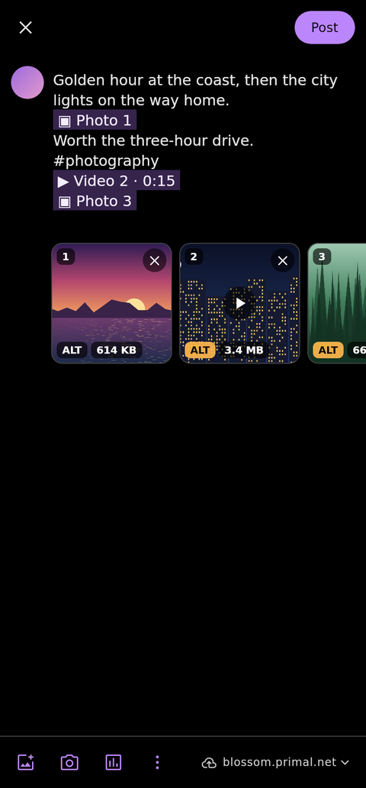

The marker reads as a chip in the text: `▣ Photo 1`, `▶ Video 2 · 0:15`. A filmstrip under the
text shows the files, numbered to match. Each tile carries only what is uploaded: its size, an
**ALT** badge (amber when missing, the nudge to add one), CW if sensitive, and remove. Tap a tile
to reopen the Studio (C). The server is one chip in the toolbar (`☁ blossom.primal.net ⌄`), not a
form field.

Cheapest to build: a span style on a text replacement, plus a row of tiles.

### B. Inline blocks inside the text field (`MarkerStyle.BLOCKS`), the default [1, 5]

| Dark | Light |
|---|---|
|  | 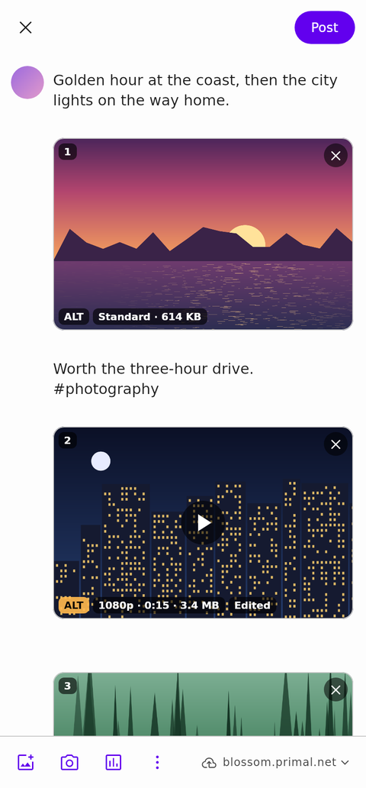 |

The media is drawn inside the field, where it will appear in the note. The text reads top to
bottom exactly as the posted note will. How: the transformation turns the marker into a single
transparent character in its own paragraph, styled with a `ParagraphStyle` line height equal to
the card's height. The field's `onTextLayout` reports where that line landed, and the composer
places the card over the hole. No custom text engine, and still one `TextFieldState`.

A cursor next to a block selects the block (highlighted border, caret hidden: the tall line
would otherwise draw a 230 dp caret). Backspace then removes it, the way a block editor behaves.

Costs and risks, to check on device before choosing B over A:

- IME behaviour around the tall line on Android (Gboard's cursor handles, text selection
  handles dragged across a block).
- Accessibility: the card needs its own semantics node ordered between the text paragraphs.
- Spell checking (`SpellCheckedTextField`) has to skip the marker range.
- The card has a fixed height (210 dp) for now. Using the real aspect ratio needs the field
  width, which is known after the first layout.

**Recommendation: B for full composers, A for small ones** (reply sheets) where a 210 dp
block doesn't fit. Both reopen the same Studio.

### C. MediaStudio: the one place per-file choices live [2, 3, 5, 6]

| Quality | Hold for original | Crop | Trim | Alt | Privacy |
|---|---|---|---|---|---|
|  |  | 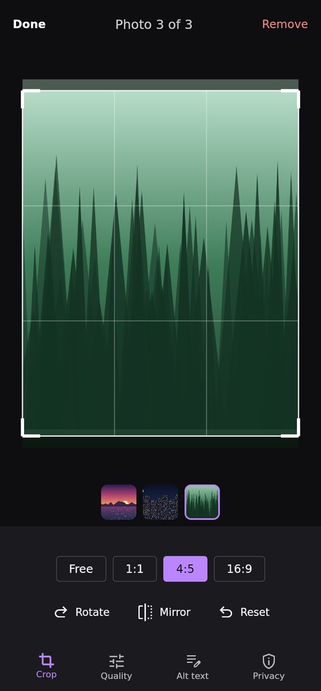 | 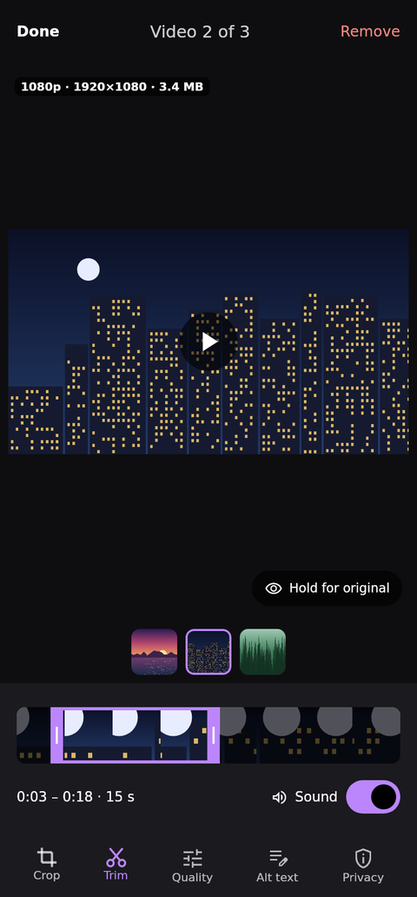 |  | 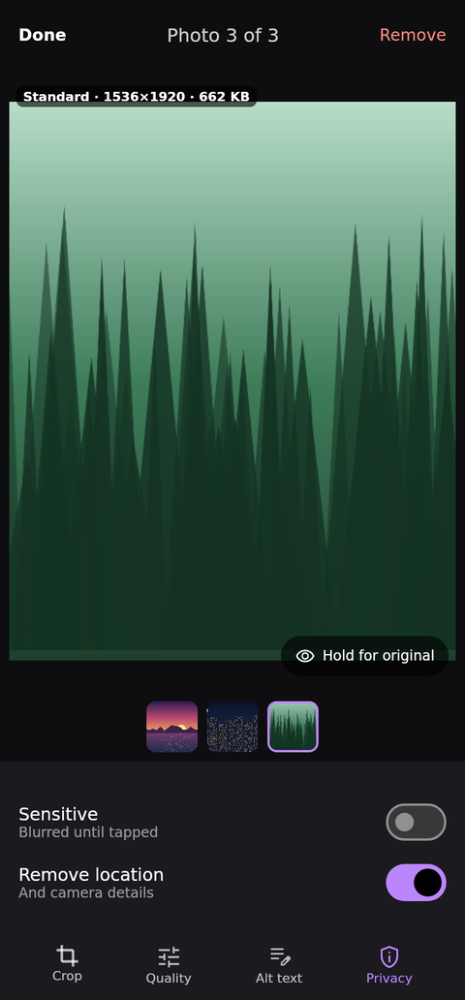 |

It opens after every pick, and again when a file is tapped. The tools are Crop, Trim (video),
Quality, Alt text and Privacy, filtered by the host's `StudioConfig`. A strip of thumbnails
switches between the files of this pick (or of the post, when reopened).

- **The big picture is the compression preview** [2, 5]. It shows the file as it will be
  uploaded at the chosen stop, with pinch, double-tap and wheel zoom (`net.engawapg` zoomable, as
  `ZoomableImageDialog` and `CompressionZoomDialog` already use). **Hold for original** flips to
  the source in place and keeps the same zoom. This merges the thumbnail, the slider's small
  preview and `CompressionZoomDialog` into one surface. The badge on top says what you get:
  `Small · 1024×768 · 192 KB`.
- **Quality is four stops** that state their cost: Small / Standard / High / Original, each with
  its estimated size and long edge, or 720p / 1080p / 1440p / Original for video. That replaces
  the title, the 30-word explainer and the slider label. `MediaQualitySlider`'s real compression
  preview (`uploader.previewImageCompression`) already produces exact sizes per level, so the
  numbers can be real, not estimated.
- **Crop** [6]: aspect presets (Free, 1:1, 4:5, 16:9), drag corners or move the frame, a
  rule-of-thirds grid, Rotate, Mirror and Reset. It works in normalized coordinates, so it
  applies the same way to the full-resolution file at upload.
- **Trim** [6]: a filmstrip with two handles and the resulting length (`0:03 – 0:18 · 15 s`),
  plus a Sound switch (strip the audio track).
- **Alt text** per file, keeping today's on-device suggestion as a chip that clears it.
- **Privacy**: Sensitive (blurred until tapped) and Remove location (and camera details), one
  line each. H.265 and GIF→MP4 leave the default screen. H.265 becomes an app setting (it is a
  device-compatibility choice, not a per-post one). GIF→MP4 becomes automatic when the server
  limit or the size would benefit, with a "Keep as GIF" option in Quality.
- Edits are live on the draft, and nothing is uploaded here [4]. The confirm button belongs to
  the host: Add, Done, Send or Save.

Implementation notes:

- Image crop and rotate: decode with the region (`BitmapRegionDecoder` on Android, Skia
  `Image.makeSubset` on desktop) inside the existing compressor step, before resizing, so it costs
  no extra pass. Crop must run before `stripMetadata` and before blurhash and thumbhash.
- Video trim: Android's compressor (LightCompressor) has no clip option. Media3 Transformer
  (`ClippingConfiguration`, androidx, Apache-2.0) does trim and mute in the same encode, and
  could later replace LightCompressor. On desktop, ffmpeg `-ss/-to` (and `-an` for mute) in the
  pipeline that already exists in `DesktopMediaUploader`.
- Icons: the bundled Material Symbols subset has no `crop`, `rotate_90_degrees_cw`,
  `content_cut` or `high_quality`. The prototypes draw stand-ins. Production adds the codepoints
  and runs `tools/material-symbols-subset/subset.sh`.

### D. Upload on Post, and recovering from a failure [4]

| Posting | Failed (inline) | Failed (chips) |
|---|---|---|
|  | 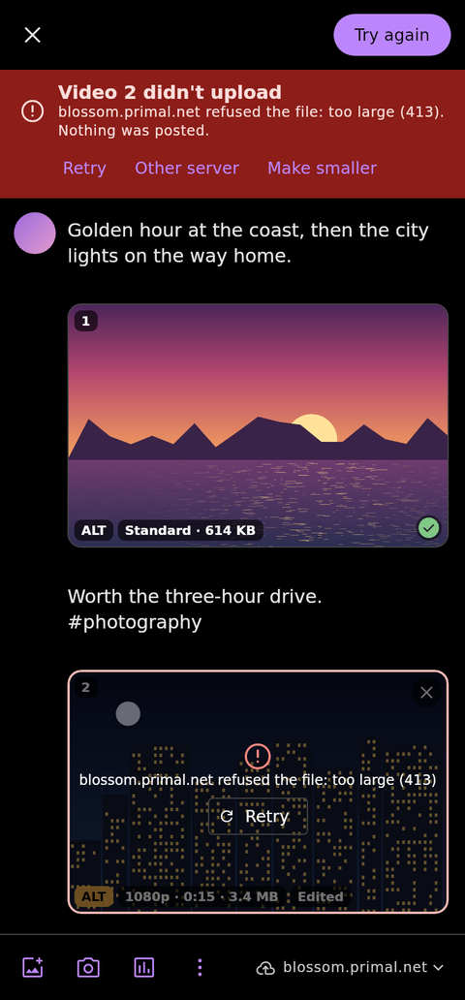 | 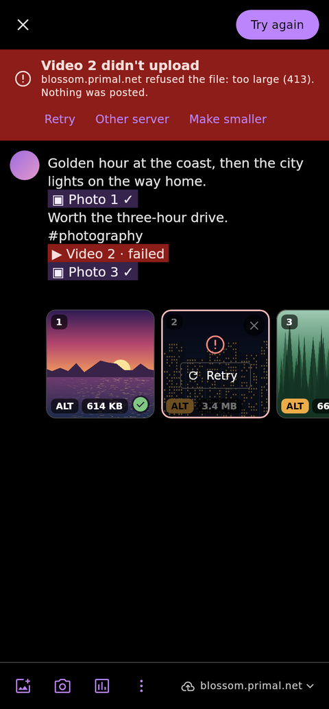 |

- Pressing Post locks the field, and the button counts files: `Uploading 1/3`. A 2 dp progress
  line under the top bar shows the overall progress. Every marker shows its own state: a ring on
  the card, a percentage on the chip, a check when done. **Cancel** returns to editing.
- Nothing is published until every file is up. On a failure the screen comes back: one banner
  names the file by its number (`Video 2 didn't upload`), gives the server's reason and
  "Nothing was posted.", and offers **Retry**, **Other server** and **Make smaller** (the obvious
  fix for a 413). The failed card turns red and carries its own Retry. Text, edits and the
  successful uploads are untouched.
- Leaving the screen while uploading should keep going in the background (the scheduled-posts
  service already publishes later), but that is a second step. The prototype keeps the user on
  the screen.

## 3. Words: before and after [3]

| Today | Proposed |
|---|---|
| "Add Image" card title, "Add to Message" button | gone: no card, no second commit |
| "File Server" spinner | `☁ blossom.primal.net ⌄` chip, only shown when there is media |
| "Sensitive Content" + "Adds sensitive content warning before showing this content" | "Sensitive" · "Blurred until tapped", in Privacy |
| "Description of the contents" + "A blue boat in a white sandy beach at sunset" | "Alt text" tab · "Describe it for people who can't see it" |
| "Remove private metadata" + "Attempts to strip private metadata from supported media files before uploading" | "Remove location" · "And camera details" |
| "Media Quality" + 30-word explainer + slider label | four labelled stops with their sizes |
| "Tap the image to zoom in and compare it with the original" + two stats lines | the picture is zoomable; "Hold for original"; one badge |
| "Use H.265/HEVC Codec" + explainer, HDR hint | moved to Settings › Media |
| "Convert GIF to MP4" + explainer | automatic, "Keep as GIF" in Quality |
| Toast "Failed to upload media" | banner naming the file, the reason, and three fixes |

About 120 words of explainer before the first scroll become under 15, and the defaults on the
composer screen are a single chip.

## 4. The same Studio on the other screens

| Chat: caption + Send | Chat: sending | Avatar: 1:1, circle | Banner: 3:1 | Profile after Save |
|---|---|---|---|---|
| 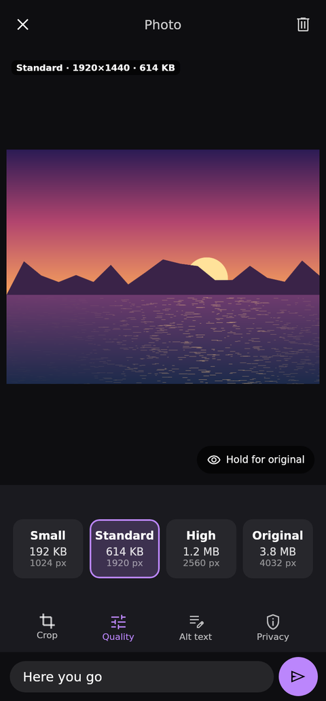 | 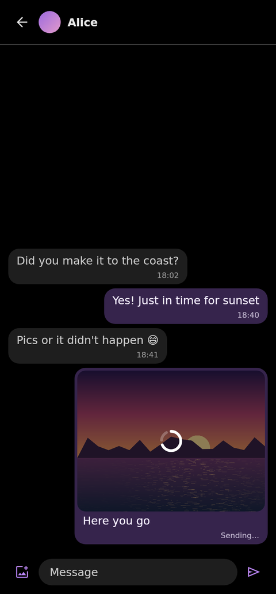 | 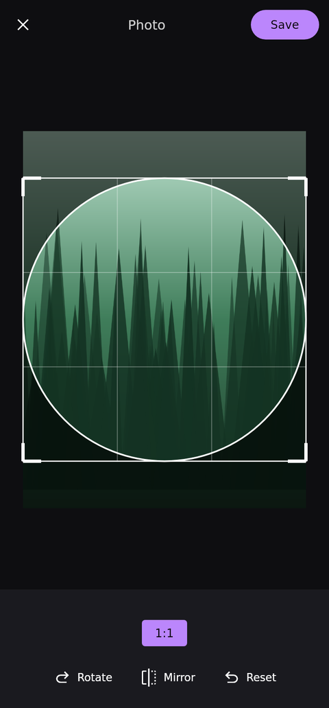 | 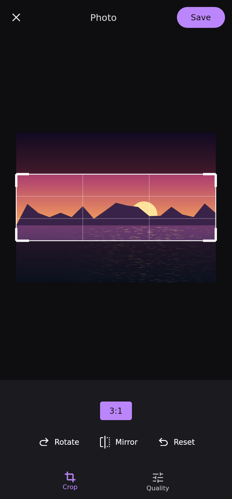 | 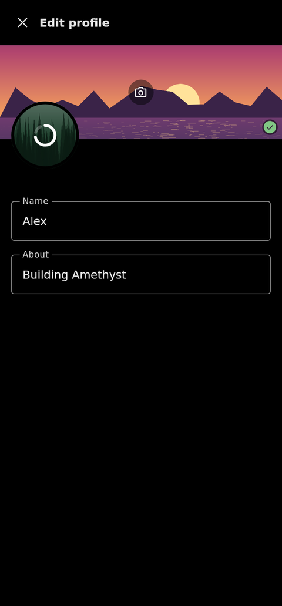 |

- **Chats** (replaces `ChatFileUploadDialog`): attach opens the Studio with a caption field and
  Send. Text already typed in the input moves into the caption, and back again on Cancel. The
  bubble appears at once and shows its upload, then sends (`HostPrototypes.kt`, `ChatPrototype`).
- **Avatar, banner and group icon** (today's `UploadToDefaultServer`, no options): the Studio
  locked to the shape the profile shows, with a circle mask for avatars. Today a wide photo
  becomes a centre-cut avatar the user never chose.
- **Picture posts** (`NewMediaView`, kind 20): the Studio is the screen, with the caption under
  it; the same as the chat config with "Post" as the label.
- **Long-form**: markers fit Markdown well (`` replaces the marker at publish).

## 5. Suggested order

1. Draft model + upload-on-Post in `ShortNotePostViewModel`, with chips (A) and the failure banner
   (D). This is the behaviour change, and it can ship on its own.
2. MediaStudio as a shared composable with `StudioConfig`, opened after every pick: Quality
   (real compression previews), Alt and Privacy. Retire `ImageVideoDescription`,
   `ChatFileUploadDialog` and `CompressionZoomDialog`.
3. Crop and rotate (both platforms), then Trim and mute (Media3 Transformer on Android, ffmpeg on
   desktop).
4. Inline blocks (B) in the note composer, after an on-device IME check.
5. Move the other hosts (comments, chats, long-form, classifieds, git issues, group DMs, avatar,
   banner, group icons) onto the Studio, each with its config.

## 6. What the prototypes are and aren't

They are Compose code in a test source set (`jvmTest`), so they ship in no artifact and their
English labels are hard-coded on purpose. Production strings go to `commonsUI` compose resources.
They run with a fake uploader (`PrototypeComposer.post()` simulates progress, and
`failNext` forces a failure), procedural stand-in images (`SyntheticMedia.kt`), and a simulated
compression (downscale and upscale) instead of real files. Crop, trim, zoom, hold-to-compare,
remove, retry and server switching all work interactively in the gallery window.

`PrototypeComposerBehaviourTest` checks the claims this doc makes about behaviour:

- Picking puts nothing in the text until Add; Add inserts the markers at the cursor in pick
  order; Cancel leaves the text and the draft list as they were.
- The avatar and banner configs crop to exactly 1:1 and 3:1 in output pixels.
- Post turns every marker into its URL only after all uploads succeed.
- A failure leaves the text and markers byte-for-byte unchanged, and Retry then finishes the post.
- Backspace after a chip, or after an inline block, removes the whole `[[media:n]]` marker
  (tested by sending a real key event to the field).

The screenshots in `screenshots/` are the render test's output, scaled down.
